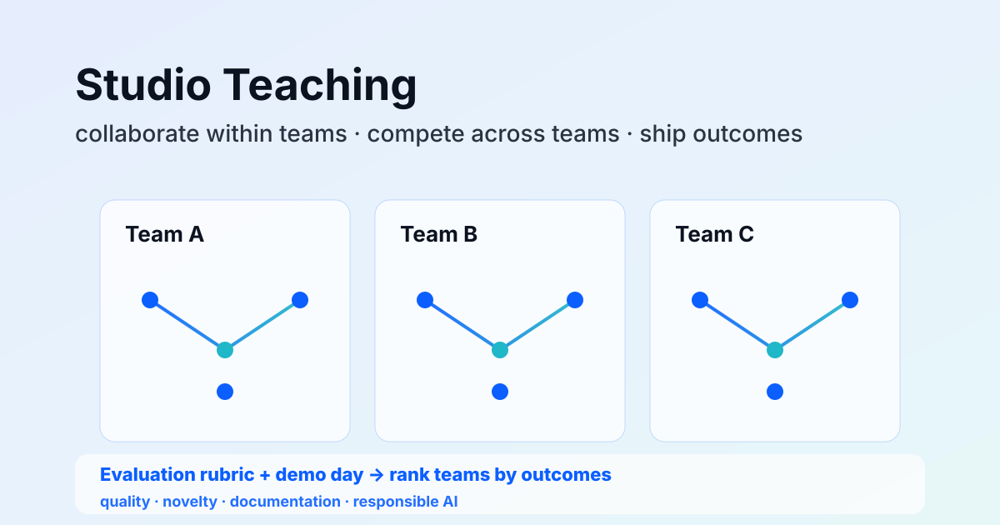

  

## About the course

Modern Educational Technology connects educational theory with practical digital production. Students design small learning experiences, test them with users, and reflect on how technology changes participation, feedback, and classroom activity.

## What we work on

- Learning design: turning a teaching objective into a clear activity and interaction.
- Digital tools: prototyping with accessible web, multimedia, and AI-assisted tools.
- Evaluation: testing whether an activity is understandable, playable, and useful for learning.
- Reflection: documenting design choices, limitations, and responsible technology use.

## Student work showcase

The course showcase collects 27 student-created learning game prototypes. You can [open the showcase](/teaching/games/), search by title or student, try a game, and like the works you enjoy.

These are classroom prototypes. Some are designed for two players or touch screens, so they may work best on a larger screen or with a partner.
