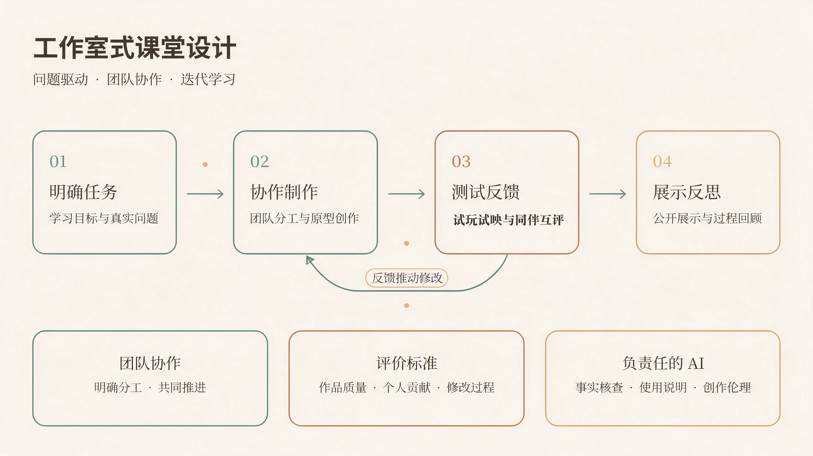

## 教学理念

我希望学生在课堂上学会提出问题、作出判断，并把想法转化为可以讨论和检验的作品。影像创作与数字学习设计都需要反复尝试：解释自己的选择，观察受众的反应，再据此修改。

生成式人工智能可以帮助探索方案、制作原型和比较不同表达，但内容的准确性、创作伦理与最终判断仍由使用者负责。评价作品时，我关注学生如何理解问题、运用证据和回应反馈。

## 课堂设计

工作室式学习是我组织课堂的总体思路，具体任务、节奏与评价方式随课程目标调整。

<figure style="margin: 1.5rem 0;">
  
  <figcaption style="margin-top: .6rem; font-size: .9rem; text-align: center;">课堂设计框架：任务、制作、反馈与反思。点击图片可查看大图。</figcaption>
</figure>

1. **提出问题**：从真实的传播或学习情境出发，明确面向谁、希望解决什么，以及怎样判断是否有效。
2. **协作制作**：通过团队分工，把想法转化为短片、互动活动或其他可体验的原型，并记录关键选择。
3. **反馈修改**：安排试玩、试映与同伴互评，用观察和反馈发现问题，完成修改。
4. **公开展示**：介绍作品及其设计依据，讨论局限，回看从初稿到成品的变化。

团队之间可以围绕共同任务开展阶段展示与交流，评价同时考虑作品质量、个人贡献和修改过程。展示是学习过程的一部分，也为下一轮创作提供依据。

## 课程与学生作品

- **[现代教育技术](/zh/teaching/modern-educational-technology/)**：学习设计、数字工具与互动教学材料。课程的[学生小游戏作品展](/zh/teaching/games/)收录 **27个可试玩原型**。
- **微电影制作**：负责摄影摄像与拍摄实训部分，结合镜头设计、现场拍摄与作品讨论。

## 课程建设

我也在准备数字摄影与摄像、影视文化等课程的教学材料，将上述课堂设计结合各课程的学习目标与创作要求逐步展开。
