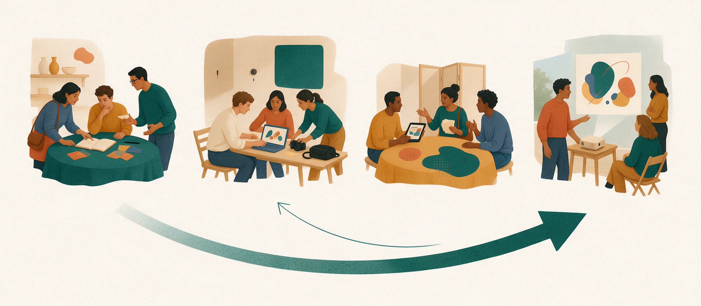

## Teaching Philosophy

I want students to learn to ask useful questions, exercise judgment, and turn ideas into work that others can discuss and test. Media production and learning design both involve repeated attempts: explaining a choice, observing an audience's response, and revising the work in light of that response.

Generative AI can help students explore alternatives, build prototypes, and compare ways of communicating. Its users remain responsible for accuracy, creative ethics, and final decisions. In assessing student work, I look at how students understand a problem, use evidence, and respond to feedback.

## Classroom Design

Studio-based learning provides an overall approach to classroom design. Tasks, pacing, and assessment are adapted to each course's learning goals.

<figure style="margin: 1.5rem 0;">
  
  <figcaption style="margin-top: .6rem; font-size: .9rem; text-align: center;">Ask a question → Make together → Test and revise → Share the work</figcaption>
</figure>

1. **Ask a question**: start with a real communication or learning context, identify the audience and purpose, and decide what would count as a useful outcome.
2. **Make together**: divide responsibilities, develop a film, interactive activity, or other prototype, and document the choices that shape it.
3. **Test and revise**: use play-testing, screenings, and peer review to identify problems and improve the work.
4. **Share the work**: present the outcome and its rationale, discuss limitations, and reflect on the changes from the first draft.

Teams can share and compare responses to a common task at successive stages. Assessment considers the work itself, individual contributions, and the revision process. Presentations are part of learning and provide a starting point for further work.

## Courses and Student Work

- **[Modern Educational Technology](/teaching/modern-educational-technology/)**: learning design, digital tools, and interactive teaching materials. The course's [student game showcase](/teaching/games/) includes **27 playable prototypes**.
- **Microfilm Production**: I teach cinematography and filming practice, connecting shot design, practical production, and discussion of student work.

## Course Development

I am also preparing materials for Digital Photography and Videography and Film and Television Culture, adapting this approach to the learning goals and creative requirements of each course.
